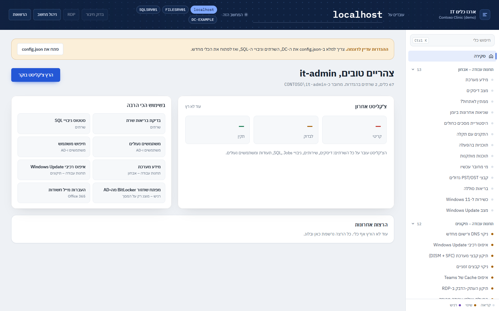
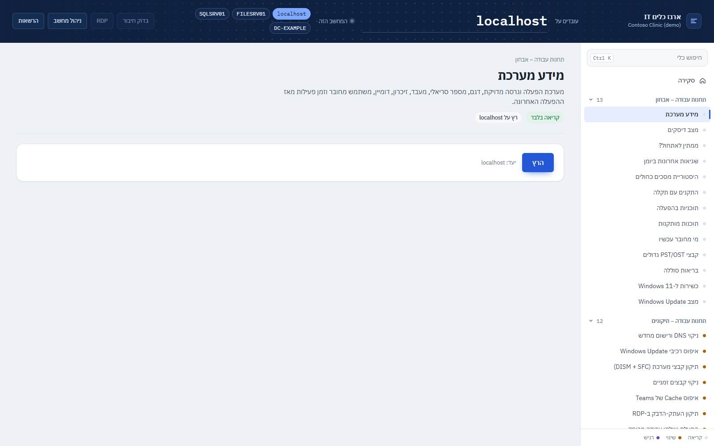

<div dir="rtl">

<h1 align="center">IT Admin Toolkit</h1>

<p align="center">
  סקריפטי PowerShell שנבדקו בשטח, מניהול ה-IT של רשת מכונים עם כמה סניפים —
  גיבויי SQL Server, ‏Microsoft 365 / Exchange Online, תיקוני Windows Update ו-Outlook, רשת ותמיכה בעמדות.
  <br/>
  <sub>כל סקריפט מקבל פרמטרים, מתועד ב-comment-based help, ובטוח כברירת מחדל (<code>-WhatIf</code>, הרצת ניסיון, גיבוי לפני שינוי).</sub>
</p>

<p align="center">
  
  
  
  
</p>
<p align="center">
  
  
  
  
</p>

<p align="center"><a href="https://galasulin.github.io/it-admin-toolkit/"></a><br/><b><a href="https://galasulin.github.io/it-admin-toolkit/">לדף החי: כל 67 הכלים ו-27 הסקריפטים ←</a></b></p>

<p align="center"><a href="README.md">🇬🇧 English</a></p>

---

## למה זה קיים

רוב סקריפטי הניהול חיים כקובצי ‎`.bat`‎ חד-פעמיים על שולחן העבודה, מלאים בשמות שרתים ותיקיות משותפות.
המאגר הזה הוא האוסף שלי — שנכתב לאורך שנים של תמיכה בסניפים, בשרתים ובמשתמשים — אחרי ניקוי, כך שכל אחד
יכול להריץ אותו: **אין סביבה קשיחה בקוד, כל ערך הוא פרמטר, וכל שינוי אפשר לראות מראש**. קובצי batch ישנים
נכתבו מחדש ב-PowerShell כשזה הפך אותם לבטוחים או פשוטים יותר.

## האפליקציה (`app/`)

ממשק מקומי בעברית שמריץ **67 כלי ניהול ב-11 קטגוריות** (אבחון תחנות, תיקונים, מדפסות, רשת, שרתים ו-SQL, משתמשי AD, ‏Microsoft 365, אבטחה, התקנות ודוחות) על המחשב הזה או על שרת יעד.

- `Start-Toolkit.ps1` מפעיל שרת HTTP ב-PowerShell **שמאזין רק ל-127.0.0.1**, עם טוקן אקראי לכל הפעלה ובדיקת Host, ופותח את הממשק בחלון. `Run-Classic.cmd` הוא חלון WPF חלופי.
- כל כלי מוגדר ב-`catalog.json` עם רמת סיכון (קריאה בלבד / משנה הגדרות / רגיש). כלים שמשנים מבקשים אישור, וכל הרצה נרשמת ביומן.
- מעתיקים את `config.example.json` ל-`config.json` (לא נכנס ל-git) וממלאים את השרתים. הצילומים מנתוני דמו (Contoso, שרתים לדוגמה).

| מסך הבית | דף כלי |
|---|---|
|  |  |

## הסקריפטים

### 🗄️ SQL Server — <a href="sql">sql/</a>

| סקריפט | מה הוא עושה |
|---|---|
| [`Backup-SqlDatabases.ps1`](sql/Backup-SqlDatabases.ps1) | גיבוי FULL / DIFF / LOG עם CHECKSUM, דחיסה ו-COPY_ONLY לבחירה, ‏RESTORE VERIFYONLY על כל קובץ, ניקוי ישנים שמוחק רק את תבנית הקבצים שלו ורק אחרי גיבוי מאומת, וקובץ לוג. |
| [`New-SqlBackupJob.sql`](sql/New-SqlBackupJob.sql) | ‏T-SQL: פרוצדורת גיבוי כללית (דחיסה, CHECKSUM, ‏RESTORE VERIFYONLY, ניקוי ישנים) ו-Job יומי ב-SQL Server Agent — לשרתים שבהם הגיבוי צריך לרוץ בתוך SQL Server. |
| [`Invoke-BackupRetention.ps1`](sql/Invoke-BackupRetention.ps1) | שמירת גיבויים בשיטת סב-אב-בן (10 יומיים / 4 שבועיים / 3 חודשיים) לכל מסד. הרצת ניסיון כברירת מחדל; **לעולם לא נוגע בגיבויי LOG**. |
| [`Invoke-SqlFile.ps1`](sql/Invoke-SqlFile.ps1) | מריץ קובץ ‎`.sql`‎ (מפוצל לפי GO) בהזדהות Windows ושומר כל הודעה ותוצאה ללוג ראיות — בלי sqlcmd. |

### ☁️ Microsoft 365 / Exchange Online — <a href="m365">m365/</a>

| סקריפט | מה הוא עושה |
|---|---|
| [`Export-DistributionLists.ps1`](m365/Export-DistributionLists.ps1) | מייצא את כל רשימות התפוצה (ואפשר גם קבוצות Microsoft 365) עם החברים, הבעלים וההגדרות ל-**Excel** ‏(ImportExcel) — או ל-CSV כשהמודול חסר. אפשר לפרוש רשימות מקוננות. |
| [`Set-AppMailSendScope.ps1`](m365/Set-AppMailSendScope.ps1) | מגביל אפליקציית Entra לשלוח מייל **רק** בשם תיבות שנבחרו (RBAC for Applications) ומוכיח זאת בבדיקה חיובית ושלילית. |
| [`Watch-AppSecretExpiry.ps1`](m365/Watch-AppSecretExpiry.ps1) | התראה יומית לפני שפג תוקף ה-Client Secret של אפליקציה (לוג, Event Log, חלון קופץ) — אחרת האינטגרציה נעצרת בשקט. |
| [`Set-OneDrivePolicies.ps1`](m365/Set-OneDrivePolicies.ps1) | התחברות שקטה ל-OneDrive, ‏Files On-Demand וסף התראה להורדה גדולה, דרך מפתחות policy, למחשבים לא מנוהלים. |

### 🔄 Windows Update — <a href="windows-update">windows-update/</a>

| סקריפט | מה הוא עושה |
|---|---|
| [`Reset-WindowsUpdate.ps1`](windows-update/Reset-WindowsUpdate.ps1) | התיקון הקלאסי: עצירת שירותים, שינוי שם ל-SoftwareDistribution ו-catroot2, הפעלה מחדש, ולבחירה DISM + SFC וסריקה חדשה. ‏<code>-StopOnly</code> רק עוצר את השירות. |
| [`Remove-WindowsUpdatePackage.ps1`](windows-update/Remove-WindowsUpdatePackage.ps1) | מסיר עדכון בעייתי לפי KB **או לפי שם חבילת DISM** (עובד גם על עדכונים מצטברים ש-wusa לא מסיר), ואפשר להשהות עדכונים. |

### 📧 Outlook — <a href="outlook">outlook/</a>

| סקריפט | מה הוא עושה |
|---|---|
| [`Backup-OutlookData.ps1`](outlook/Backup-OutlookData.ps1) | מעתיק חתימות, הגדרות Outlook וקובצי PST (ולבחירה OST) של המשתמש עם robocopy, ומוסיף הוראות שחזור. |
| [`Set-OutlookRegistryFixes.ps1`](outlook/Set-OutlookRegistryFixes.ps1) | תיקוני Outlook לכל גרסה: ביטול winmail.dat ‏(TNEF), חלון מאפייני GAL הקלאסי, יותר חשבונות Exchange בפרופיל — עם גיבוי ‎`.reg`‎ ו-<code>-Revert</code>. |
| [`Remove-OfficeMsiPatch.ps1`](outlook/Remove-OfficeMsiPatch.ps1) | מסיר עדכון Office בודד מסוג MSI (ברירת מחדל: העדכון שגרם ל-Outlook 2010 לעלות במצב בטוח). |

### 🌐 רשת — <a href="network">network/</a>

| סקריפט | מה הוא עושה |
|---|---|
| [`Add-FirewallPortRule.ps1`](network/Add-FirewallPortRule.ps1) | חוקי חומת אש מתבניות (SQL Server, ‏SSAS, ‏RDP, פינג) או פורטים לבחירה, בלי כפילויות, מוגבלים לפרופיל ולמקור. |
| [`Export-FirewallConfig.ps1`](network/Export-FirewallConfig.ps1) | מייצא את מדיניות חומת האש (‎`.wfw`‎) ו-CSV של כל החוקים; ייבוא / איפוס עם גיבוי אוטומטי קודם. |
| [`Set-DnsServers.ps1`](network/Set-DnsServers.ps1) | מגדיר שרתי DNS קבועים או חזרה ל-DHCP, ואז מנקה ורושם מחדש ב-DNS. |
| [`Repair-TimeSync.ps1`](network/Repair-TimeSync.ps1) | מתקן סנכרון שעון: היררכיית הדומיין או שרתי NTP ידניים, גיבוי ההגדרות וסנכרון כפוי. |
| [`Connect-NetworkDrives.ps1`](network/Connect-NetworkDrives.ps1) | ממפה כוננים מקובץ CSV, באופן קבוע, עם הרשאה שנשאלת בזמן ריצה — בלי סיסמאות בקבצים. |

### 💻 עמדות קצה — <a href="endpoint">endpoint/</a>

| סקריפט | מה הוא עושה |
|---|---|
| [`Get-EndpointInfo.ps1`](endpoint/Get-EndpointInfo.ps1) | דוח תמיכה בקובץ אחד: משתמש וקבוצות, רשת, מערכת הפעלה, מספר סידורי / Service Tag, דיסקים, כרטיס מסך, תוכנות מותקנות. |
| [`Get-LocalAdmins.ps1`](endpoint/Get-LocalAdmins.ps1) | ביקורת חברי קבוצת Administrators המקומית במחשב אחד או רבים (לפי SID, בלי תלות בשפה) ל-CSV. |
| [`Clear-PrintSpooler.ps1`](endpoint/Clear-PrintSpooler.ps1) | מנקה עבודות הדפסה תקועות, מקומית או מרחוק. |
| [`New-ShadowCopy.ps1`](endpoint/New-ShadowCopy.ps1) | יוצר Shadow Copy ‏("גרסאות קודמות") ולבחירה מגדיר את גודל האחסון שלהן. |
| [`Repair-RdpClientLicenseStore.ps1`](endpoint/Repair-RdpClientLicenseStore.ps1) | מתקן את שגיאת "licensing protocol" של לקוח RDP אצל משתמשים רגילים, עם גיבוי ושחזור של ההרשאות. |
| [`audio/Get-AudioDiagnostics.ps1`](endpoint/audio/Get-AudioDiagnostics.ps1) | אבחון מעמיק לקריאה בלבד של שמע קטוע: פורמטים, שרשרת APO, דרייברים, חשמל, מדידת DPC חיה, יומני אירועים. |
| [`audio/Repair-AudioStutter.ps1`](endpoint/audio/Repair-AudioStutter.ps1) | דוח / <code>-Apply</code> / <code>-Rollback</code> לתיקון קיטועים של Nahimic, ‏Fast Startup ומינימום מעבד בסוללה. |
| [`audio/Test-AudioFix.ps1`](endpoint/audio/Test-AudioFix.ps1) | בדיקת PASS / FAIL אחרי התיקון. |

### 👥 Active Directory — <a href="ad">ad/</a>

| סקריפט | מה הוא עושה |
|---|---|
| [`Move-StaleComputers.ps1`](ad/Move-StaleComputers.ps1) | מדווח על מחשבים שלא התחברו N ימים; לבחירה משבית אותם (עם חותמת בתיאור) ומעביר ל-OU. |

## איך מריצים

<div dir="ltr">

```powershell
# 1. Read the help first
Get-Help .\sql\Backup-SqlDatabases.ps1 -Full

# 2. Allow local scripts for this session only
Set-ExecutionPolicy -Scope Process -ExecutionPolicy Bypass -Force

# 3. Preview, then run
.\windows-update\Reset-WindowsUpdate.ps1 -WhatIf
.\windows-update\Reset-WindowsUpdate.ps1
```

</div>

- הסקריפטים שמורים ב-**UTF-8 עם BOM**, כך ש-Windows PowerShell 5.1 קורא אותם נכון.
- רוב הסקריפטים שמשנים את המערכת דורשים PowerShell **כמנהל** (מצוין ב-‎`.NOTES`‎ של כל סקריפט).
- מודולים אופציונליים: ExchangeOnlineManagement, ‏ImportExcel, ‏ActiveDirectory ‏(RSAT).
- ערכים בסוגריים משולשים כמו ‎`<FILE_SERVER>`‎, ‏‎`<ADMIN_UPN>`‎ או ‎`<TENANT_ID_GUID>`‎ הם מצייני מקום — יש להחליף בערכים שלכם.

## ⚠️ בטיחות

הסקריפטים משנים שרתים, שירותים, רישום, חומת אש וגיבויים. הם נבנו בזהירות — <code>-WhatIf</code> ו-<code>-Confirm</code>
בכל מקום שיש שינוי, הרצת ניסיון כברירת מחדל לכל מה שמוחק, גיבוי (‎`.reg`‎, ‏‎`.wfw`‎, הרשאות) לפני שינוי, ומתג
החזרה כשאפשר — אבל הם מסופקים **כמות שהם (AS IS)**. בדקו קודם בסביבת ניסוי או על מחשב אחד, קראו את ה-help ושמרו גיבויים.

## טכנולוגיות

PowerShell 5.1 / 7 · Windows 10 / 11 / Server · SQL Server ‏(T-SQL, System.Data.SqlClient) ·
Exchange Online PowerShell · ImportExcel · Active Directory · NetSecurity / DnsClient · DISM · robocopy · WMI / CIM

## התפקיד שלי

אני מנהל ה-IT של רשת מכוני פיזיותרפיה עם כמה סניפים. כתבתי את הסקריפטים האלה לתקלות אמיתיות ולמשימות
חוזרות — גיבויי שרתים, ניהול Microsoft 365, עדכונים תקועים, בעיות Outlook, רשת בסניפים ועבודת helpdesk —
ובהמשך ניקיתי, הכללתי ותיעדתי אותם לפרסום. חלק מהחדשים נכתבו יחד עם עוזר קוד מבוסס AI בהכוונה שלי,
ונבדקו על ידי.

## סטטוס

בשימוש ובתחזוקה. Issues ו-Pull Requests יתקבלו בברכה.

## פרטיות

כל מה שקשור לסביבה מסוימת הוסר לפני הפרסום: שמות שרתים ומחשבים, דומיינים, שמות משתמשים, תיבות דואר,
תיקיות משותפות, כתובות IP, מזהי tenant ואפליקציות והרשאות גישה — כולם הפכו לפרמטרים או למצייני מקום ניטרליים
(‎`contoso.local`‎, ‏‎`<SQL_SERVER>`‎, ‏‎`\\<FILE_SERVER>\<SHARE>`‎). לא נכללים נתוני ארגון אמיתיים, לוגים או
קובצי ייצוא, וה-‎`.gitignore`‎ מונע הכנסה של פלט סקריפטים (logs/, ‏exports/, ‏CSV/XLSX) למאגר.

---

**Built by [Gal Asulin](https://github.com/galasulin), IT Manager**

</div>
