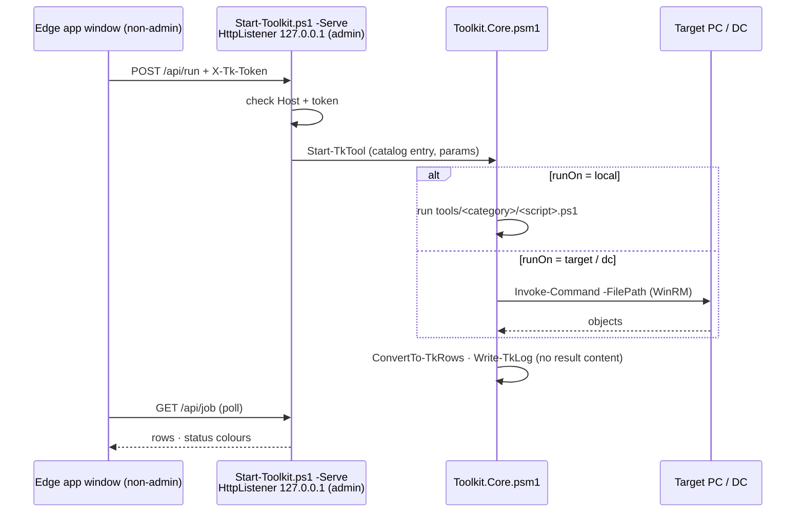

<p align="center"><a href="https://galasulin.github.io/it-admin-toolkit/"></a></p>

<div align="center">

# IT Admin Toolkit

**ממשק Web מקומי בעברית עם 67 כלי ניהול, ועוד 27 סקריפטי PowerShell שנבדקו בשטח, מניהול ה-IT של רשת מכונים עם כמה סניפים.**

🇬🇧 [English](README.md) · 🇮🇱 עברית


[**דף חי**](https://galasulin.github.io/it-admin-toolkit/) · [מסכים](#מסכים) · [ארכיטקטורה](#ארכיטקטורה) · [טכנולוגיה](#פרמטרים-טכניים)

</div>

<div dir="rtl" align="right">

## במבט מהיר

| | |
|---|---|
| **סוג** | אפליקציית ניהול מקומית (שרת PowerShell, ממשק React) וספריית סקריפטים עצמאיים ב-PowerShell ו-T-SQL |
| **סטטוס** | בשימוש שוטף ובתחזוקה |
| **סטאק** | PowerShell 5.1 / 7 · ‏`HttpListener` · ‏WinRM · ‏React 19 · ‏Vite 8 · ‏GSAP · חלון WPF חלופי |
| **התפקיד שלי** | כתבתי הכול: כל כלי וסקריפט, האפליקציה, הממשק ודף התיעוד |
| **דמו חי** | [galasulin.github.io/it-admin-toolkit](https://galasulin.github.io/it-admin-toolkit/) (קטלוג של כל הכלים והסקריפטים) |
| **שפות** | עברית (ממשק האפליקציה) · אנגלית (סקריפטים ו-comment-based help) |

## מסכים

<table>
<tr>
<td width="50%"><a href="docs/screenshots/app-home.png"></a><br><sub><b>מסך הבית</b> · בחירת יעד, צ'קליסט בוקר, הכלים הנפוצים, תפריט צד של 11 קטגוריות</sub></td>
<td width="50%"><a href="docs/screenshots/app-tool.png"></a><br><sub><b>דף כלי</b> · תיאור, תגית סיכון, יעד וכפתור הרצה</sub></td>
</tr>
</table>

<sub>הצילומים מנתוני דמו (Contoso, שרתים לדוגמה).</sub>

## מה זה

רוב סקריפטי הניהול חיים כקובצי ‎`.bat`‎ חד-פעמיים על שולחן העבודה, מלאים בשמות שרתים ותיקיות משותפות. הריפו הזה הוא האוסף שלי, שנכתב לאורך שנים של תמיכה בסניפים, בשרתים ובמשתמשים, אחרי ניקוי כך שכל אחד יכול להריץ אותו: **אין סביבה קשיחה בקוד, כל ערך הוא פרמטר, וכל שינוי אפשר לראות מראש**. קובצי batch ישנים נכתבו מחדש ב-PowerShell כשזה הפך אותם לבטוחים או פשוטים יותר.

יש בו שני חלקים. ‏`app/` הוא ממשק Web מקומי בעברית שמריץ **67 כלים ב-11 קטגוריות** על המחשב הזה, על כל מחשב בדומיין דרך WinRM, או על ה-Domain Controller. בתיקיות הסקריפטים יש **27 סקריפטים עצמאיים** לגיבויי SQL Server, ‏Microsoft 365, ‏Windows Update, ‏Outlook, רשת, עמדות קצה ו-AD.

## יכולות מרכזיות

### האפליקציה: 67 כלים ב-11 קטגוריות

| קטגוריה | כלים | דוגמאות |
|---|:-:|---|
| תחנות עבודה: אבחון | 13 | מידע מערכת, מצב דיסקים ו-SMART, ממתין לאתחול, היסטוריית מסכים כחולים, התקנים עם תקלה, כשירות ל-Windows 11, קובצי PST/OST גדולים |
| תחנות עבודה: תיקונים | 12 | ניקוי DNS ורישום מחדש, איפוס Windows Update, ‏DISM + SFC, איפוס Cache של Teams, תיקון העתק-הדבק ב-RDP, אתחול מתוזמן, נקודת שחזור |
| הקמה ושדרוגים | 5 | התקנת תוכנות סטנדרטיות ב-winget, תוכנות עם עדכון, עדכון הכול, שינוי שם וצירוף לדומיין, שדרוג Windows |
| מדפסות | 3 | מצב מדפסות ותורים, תיקון Spooler, הוספת מדפסת רשת לכל המשתמשים |
| שרתים | 5 | בדיקת בריאות שרת, סטטוס גיבויי SQL, ‏Jobs של SQL Agent, תעודות שעומדות לפוג, שיתופים פתוחים מדי |
| משתמשים ו-AD | 8 | חיפוש משתמש, משתמשים נעולים, שחרור נעילה, איפוס סיסמה, משתמש חדש לפי תבנית, השבתת עובד שעוזב, חברי קבוצה, חשבונות לא פעילים |
| Office 365 | 6 | חברי רשימת תפוצה, העברות מייל חשודות, הרשאות לתיבות, גודל תיבות, רישיונות, מצב MFA |
| אבטחה | 4 | ‏Local Admins, מצב BitLocker, מצב Defender, כניסות שנכשלו (מה-DC) |
| רגיש (מוצג רק על המסך) | 5 | סיסמאות Wi-Fi שמורות, מפתחות רישיון, מפתחות שחזור BitLocker (מקומי / AD), בדיקת קובץ ב-VirusTotal |
| רשת | 3 | בדיקת חיבור ופורטים, בדיקת גישה ב-WinRM, סריקת מכשירים ברשת |
| דוחות | 3 | צ'קליסט בוקר לכל השרתים, מלאי מחשבים, הפעלת דוח בוקר אוטומטי |

- **מודל סיכון בקוד:** כל כלי ב-`catalog.json` מסומן `read` ‏(39), ‏`change` ‏(23) או `sensitive` ‏(5). כלי קריאה רצים מיד. כלי שינוי מציגים בדיוק מה יקרה, על איזה יעד ועם אילו פרמטרים, ורצים רק אחרי "כן". כלים רגישים מבקשים אישור לפני ההצגה, ואישור נוסף לפני שמירה לקובץ.
- **אין מחיקות:** התיקיות של Windows Update ו-Teams מקבלות שם חדש, עובד שעוזב מושבת ולא נמחק, ועבודות הדפסה תקועות עוברות לתיקיית גיבוי. החריג היחיד, ניקוי קבצים זמניים, כתוב במפורש בחלון האישור.
- **יומן ביקורת:** כל הרצה נרשמת ב-`logs\toolkit-YYYY-MM.log`: מי, מתי, איזה כלי, על איזה יעד, עם אילו פרמטרים ומה התוצאה. תוכן התוצאות לא נרשם, כך שסיסמאות ומפתחות לא מגיעים ללוג.
- **סיסמאות:** איפוס סיסמה ומשתמש חדש מקבלים סיסמה זמנית אקראית שמוצגת פעם אחת, עם חובת החלפה בכניסה הבאה.
- **ייצוא ודוחות:** תוצאות נשמרות ל-CSV או HTML. צ'קליסט הבוקר יכול לרוץ כמשימה מתוזמנת בימים א'-ה' ושומר `reports\daily-YYYYMMDD.html`.
- **‏Ctrl+K** פותח חיפוש מהיר בכל הכלים. יש מצב בהיר וכהה, והגופנים מותקנים מקומית, כך שהממשק עובד גם בלי אינטרנט.

### הסקריפטים: 27 ב-7 תיקיות

#### SQL Server: [`sql/`](sql)

| סקריפט | מה הוא עושה |
|---|---|
| [`Backup-SqlDatabases.ps1`](sql/Backup-SqlDatabases.ps1) | גיבוי FULL / DIFF / LOG עם `CHECKSUM`, דחיסה ו-`COPY_ONLY` לבחירה, ‏`RESTORE VERIFYONLY` על כל קובץ, ניקוי ישנים שמוחק רק את תבנית הקבצים שלו ורק אחרי גיבוי מאומת, וקובץ לוג. |
| [`New-SqlBackupJob.sql`](sql/New-SqlBackupJob.sql) | ‏T-SQL: פרוצדורת גיבוי כללית (דחיסה, CHECKSUM, ‏`RESTORE VERIFYONLY`, ניקוי ישנים) ו-Job יומי ב-SQL Server Agent, לשרתים שבהם הגיבוי צריך לרוץ בתוך SQL Server. |
| [`Invoke-BackupRetention.ps1`](sql/Invoke-BackupRetention.ps1) | שמירת גיבויים בשיטת סב-אב-בן (10 יומיים / 4 שבועיים / 3 חודשיים) לכל מסד. הרצת ניסיון כברירת מחדל; **לעולם לא נוגע בגיבויי LOG**. |
| [`Invoke-SqlFile.ps1`](sql/Invoke-SqlFile.ps1) | מריץ קובץ ‎`.sql`‎ (מפוצל לפי `GO`) בהזדהות Windows ושומר כל הודעה ותוצאה ללוג ראיות, בלי `sqlcmd`. |

#### Microsoft 365 / Exchange Online: ‏[`m365/`](m365)

| סקריפט | מה הוא עושה |
|---|---|
| [`Export-DistributionLists.ps1`](m365/Export-DistributionLists.ps1) | מייצא את כל רשימות התפוצה (ואפשר גם קבוצות Microsoft 365) עם החברים, הבעלים וההגדרות ל-**Excel** ‏(ImportExcel), או ל-CSV כשהמודול חסר. אפשר לפרוש רשימות מקוננות. |
| [`Set-AppMailSendScope.ps1`](m365/Set-AppMailSendScope.ps1) | מגביל אפליקציית Entra לשלוח מייל **רק** בשם תיבות שנבחרו (RBAC for Applications) ומוכיח זאת בבדיקה חיובית ושלילית. |
| [`Watch-AppSecretExpiry.ps1`](m365/Watch-AppSecretExpiry.ps1) | התראה יומית לפני שפג תוקף ה-Client Secret של אפליקציה (לוג, Event Log, חלון קופץ). בלי זה האינטגרציה נעצרת בשקט. |
| [`Set-OneDrivePolicies.ps1`](m365/Set-OneDrivePolicies.ps1) | התחברות שקטה ל-OneDrive, ‏Files On-Demand וסף התראה להורדה גדולה, דרך מפתחות policy, למחשבים לא מנוהלים. |

#### Windows Update: ‏[`windows-update/`](windows-update)

| סקריפט | מה הוא עושה |
|---|---|
| [`Reset-WindowsUpdate.ps1`](windows-update/Reset-WindowsUpdate.ps1) | התיקון הקלאסי: עצירת שירותים, שינוי שם ל-`SoftwareDistribution` ו-`catroot2`, הפעלה מחדש, ולבחירה DISM + SFC וסריקה חדשה. ‏`-StopOnly` רק עוצר את השירות. |
| [`Remove-WindowsUpdatePackage.ps1`](windows-update/Remove-WindowsUpdatePackage.ps1) | מסיר עדכון בעייתי לפי KB **או לפי שם חבילת DISM** (עובד גם על עדכוני RollupFix מצטברים ש-`wusa` לא מסיר), ואפשר להשהות עדכונים. |

#### Outlook: ‏[`outlook/`](outlook)

| סקריפט | מה הוא עושה |
|---|---|
| [`Backup-OutlookData.ps1`](outlook/Backup-OutlookData.ps1) | מעתיק חתימות, הגדרות Outlook וקובצי PST (ולבחירה OST) של המשתמש עם robocopy, ומוסיף הוראות שחזור. |
| [`Set-OutlookRegistryFixes.ps1`](outlook/Set-OutlookRegistryFixes.ps1) | תיקוני Outlook לכל גרסה: ביטול `winmail.dat` ‏(TNEF), חלון מאפייני GAL הקלאסי, יותר חשבונות Exchange בפרופיל, עם גיבוי ‎`.reg`‎ ו-`-Revert`. |
| [`Remove-OfficeMsiPatch.ps1`](outlook/Remove-OfficeMsiPatch.ps1) | מסיר עדכון Office בודד מסוג MSI (ברירת מחדל: העדכון שגרם ל-Outlook 2010 לעלות במצב בטוח). |

#### רשת: [`network/`](network)

| סקריפט | מה הוא עושה |
|---|---|
| [`Add-FirewallPortRule.ps1`](network/Add-FirewallPortRule.ps1) | חוקי חומת אש מתבניות (SQL Server, ‏SSAS, ‏RDP, פינג) או פורטים לבחירה, בלי כפילויות, מוגבלים לפרופיל ולמקור. |
| [`Export-FirewallConfig.ps1`](network/Export-FirewallConfig.ps1) | מייצא את מדיניות חומת האש (‎`.wfw`‎) ו-CSV של כל החוקים; ייבוא או איפוס עם גיבוי אוטומטי קודם. |
| [`Set-DnsServers.ps1`](network/Set-DnsServers.ps1) | מגדיר שרתי DNS קבועים או חזרה ל-DHCP, ואז מנקה ורושם מחדש ב-DNS. |
| [`Repair-TimeSync.ps1`](network/Repair-TimeSync.ps1) | מתקן סנכרון שעון: היררכיית הדומיין או שרתי NTP ידניים, גיבוי ההגדרות וסנכרון כפוי. |
| [`Connect-NetworkDrives.ps1`](network/Connect-NetworkDrives.ps1) | ממפה כוננים מקובץ CSV, באופן קבוע, עם הרשאה שנשאלת בזמן ריצה. בלי סיסמאות בקבצים. |

#### עמדות קצה: [`endpoint/`](endpoint)

| סקריפט | מה הוא עושה |
|---|---|
| [`Get-EndpointInfo.ps1`](endpoint/Get-EndpointInfo.ps1) | דוח תמיכה בקובץ אחד: משתמש וקבוצות, רשת, מערכת הפעלה, מספר סידורי / Service Tag, דיסקים, כרטיס מסך, תוכנות מותקנות. |
| [`Get-LocalAdmins.ps1`](endpoint/Get-LocalAdmins.ps1) | ביקורת חברי קבוצת Administrators המקומית במחשב אחד או רבים (לפי SID, בלי תלות בשפה) ל-CSV. |
| [`Clear-PrintSpooler.ps1`](endpoint/Clear-PrintSpooler.ps1) | מנקה עבודות הדפסה תקועות, מקומית או מרחוק. |
| [`New-ShadowCopy.ps1`](endpoint/New-ShadowCopy.ps1) | יוצר Shadow Copy ‏("גרסאות קודמות") ולבחירה מגדיר את גודל האחסון שלהן. |
| [`Repair-RdpClientLicenseStore.ps1`](endpoint/Repair-RdpClientLicenseStore.ps1) | מתקן את שגיאת "licensing protocol" של לקוח RDP אצל משתמשים רגילים, עם גיבוי ושחזור של ההרשאות. |
| [`audio/Get-AudioDiagnostics.ps1`](endpoint/audio/Get-AudioDiagnostics.ps1) | אבחון מעמיק לקריאה בלבד של שמע קטוע: פורמטים, שרשרת APO, דרייברים, חשמל, מדידת DPC חיה, יומני אירועים. |
| [`audio/Repair-AudioStutter.ps1`](endpoint/audio/Repair-AudioStutter.ps1) | דוח / `-Apply` / `-Rollback` לתיקון קיטועים של Nahimic, ‏Fast Startup ומינימום מעבד בסוללה. |
| [`audio/Test-AudioFix.ps1`](endpoint/audio/Test-AudioFix.ps1) | בדיקת PASS / FAIL אחרי התיקון. |

#### Active Directory: ‏[`ad/`](ad)

| סקריפט | מה הוא עושה |
|---|---|
| [`Move-StaleComputers.ps1`](ad/Move-StaleComputers.ps1) | מדווח על מחשבים שלא התחברו N ימים; לבחירה משבית אותם (עם חותמת בתיאור) ומעביר ל-OU. |

## ארכיטקטורה


‏`Run.cmd` מפעיל את `Start-Toolkit.ps1` בשני שלבים. השלב הראשון, בלי הרשאות מנהל, בוחר פורט פנוי על ה-loopback וטוקן אקראי של 24 בתים, מפעיל את שלב השרת כמנהל, ופותח את Edge במצב אפליקציה עם פרופיל נפרד ו**בלי** הרשאות מנהל. שלב השרת הוא `HttpListener` של PowerShell שמאזין רק ל-`127.0.0.1`; הוא מגיש את ממשק ה-React הבנוי מ-`web/` ו-API קטן ב-JSON. כל בקשה חייבת לשאת את הטוקן של ההפעלה ו-Header של `Host` שהוא בדיוק `127.0.0.1:<port>` (הגנה מ-DNS rebinding). ‏`modules/Toolkit.Core.psm1` מאתר את הכלי ב-`catalog.json`, מריץ את הסקריפט מקומית או שולח את אותו קובץ ליעד עם `Invoke-Command -FilePath` דרך WinRM, ממיר את הפלט לשורות, כותב ליומן ומייצא ל-CSV או HTML. כלי Microsoft 365 נפתחים בחלון קונסולה נפרד, כי ההתחברות שם אינטראקטיבית.

### זרימה

<div dir="ltr">



</div>

## פרמטרים טכניים

| פרמטר | ערך |
|---|---|
| כלי האפליקציה | 67 רשומות ב-`app/catalog.json`, ב-11 קטגוריות |
| רמות סיכון | 39 `read` · ‏23 `change` · ‏5 `sensitive` |
| איפה הכלים רצים | 44 על יעד נבחר · 10 על ה-Domain Controller · 7 מקומית · 6 בקונסולה נפרדת (Microsoft 365) |
| כלים עם פרמטרים / פעולות המשך | 30 עם `params` · ‏24 עם `actions` |
| סקריפטים עצמאיים | 27 (‏26 ‏`.ps1` ו-1 ‏`.sql`) ב-7 תיקיות, 3,751 שורות |
| קוד PowerShell של האפליקציה | `Start-Toolkit.ps1` ‏309 שורות · `Start-Classic.ps1` ‏319 · `Toolkit.Core.psm1` ‏185 · יחד עם הכלים 2,240 שורות |
| API מקומי | `HttpListener` על `127.0.0.1:<פורט אקראי>` · ‏9 נקודות קצה (`bootstrap`, `run`, `job`, `stop`, `export`, `open`, `cred`, `ping`, `quit`) |
| אימות בקשות | טוקן אקראי של 24 בתים לכל הפעלה (`X-Tk-Token`) ובדיקה מדויקת של `Host` |
| כיבוי עצמי | השרת נסגר 180 שניות אחרי ה-ping האחרון, ורק אם אף כלי לא רץ |
| הרצה מרחוק | ‏WinRM / ‏`Invoke-Command -FilePath`; כל סקריפט כלי עצמאי (`param([hashtable]$P)`) |
| ממשק | React 19.3, ‏Vite 8.3, ‏GSAP 3.15, ‏Lenis, ‏Motion; באנדל בנוי של כ-433KB ‏JS וכ-30KB ‏CSS; גופני IBM Plex Sans Hebrew / Mono מקומיים |
| ממשק חלופי | חלון WPF ‏(`Run-Classic.cmd`, ‏`ui/MainWindow.xaml`) על אותו קטלוג |
| סביבת ריצה | Windows PowerShell 5.1 או PowerShell 7 · ‏Windows 10 / 11 / Server · ‏Edge במצב אפליקציה |
| קידוד | UTF-8 עם BOM (חובה לעברית ב-Windows PowerShell 5.1) |
| מודולים אופציונליים | `ExchangeOnlineManagement`, ‏`Microsoft.Graph.Authentication`, ‏`ImportExcel`, ‏`ActiveDirectory` ‏(RSAT) |
| QA | `qa/QA.ps1` מריץ כל כלי קריאה-בלבד על המחשב המקומי ושומר ל-`qa/qa-results.json`; לעולם לא מריץ כלי שמשנה משהו |
| דף התיעוד | `docs/index.html` נבנה על ידי `docs/build_page.py` מתוך `catalog.json` ומה-`.SYNOPSIS` של הסקריפטים |

## החלטות הנדסיות

| ההחלטה | למה | המחיר |
|---|---|---|
| **ממשק Web מקומי על `HttpListener` ב-loopback, לא שירות מתארח** | בלי התקנה, בלי סוכן, בלי פורט פתוח לרשת. הטוקן ובדיקת ה-`Host` חוסמים דפים מקומיים אחרים ו-DNS rebinding. | רץ על כל מחשב מנהל בנפרד; אין קונסולה משותפת לכמה משתמשים. |
| **השרת רץ כמנהל, הדפדפן לא** | הכלים צריכים הרשאות מנהל; הדפדפן שמציג אותם לא. | שני תהליכים ובקשת UAC בכל הפעלה. |
| **סקריפטי כלים עצמאיים שנשלחים עם `Invoke-Command -FilePath`** | אותו קובץ עובד מקומית ומרחוק ב-WinRM, בלי להתקין כלום ביעד. | אין dot-source לפונקציות משותפות, ולכן יש קוד שחוזר בין כלים. צריך WinRM פעיל בתחנות. |
| **ממשק שנבנה מקטלוג, עם רמת סיכון לכל כלי** | כלי חדש הוא סקריפט ורשומה אחת ב-`catalog.json`; כללי האישור נגזרים מרמת הסיכון ולא מכל כלי בנפרד. | הסיכון מוצהר ידנית, כך שתיוג שגוי נתפס רק בסקירה. |
| **שינוי שם, השבתה, העברה; לא מחיקה** | כל תיקון אפשר להחזיר ידנית. | תיקיות ששמן שונה וחשבונות מושבתים דורשים ניקוי מדי פעם. |
| **ביומן נרשמים פרטי ההרצה, לא התוצאות** | יומן ביקורת מלא בלי לשמור סיסמאות, מפתחות או מידע אישי. | אי אפשר לשחזר תוצאות ישנות מהיומן. |

## איך מריצים

### האפליקציה

1. מחלצים את התיקייה, למשל ל-`C:\IT-Toolkit`.
2. מעתיקים את `app/config.example.json` ל-`app/config.json` (לא נכנס ל-git) וממלאים DC, שרתים, מופעי SQL ותיקיות גיבוי. אם הקובץ חסר, האפליקציה יוצרת אותו מהדוגמה ומציגה באנר עם כפתור שפותח אותו.
3. לחיצה כפולה על `app/Run.cmd`, אישור UAC, ונפתח חלון אפליקציה של Edge. אם משהו לא נפתח, `app/Run-Classic.cmd` פותח את חלון ה-WPF עם אותם כלים.

| שדה ב-`config.json` | מה זה |
|---|---|
| `OrgName` | שם שיופיע בכותרת |
| `DomainController` | שם ה-DC. כלי ה-AD רצים עליו, כך שלא צריך RSAT במחשב שלך |
| `Servers` | רשימת שרתים. ב-`SqlInstances` כותבים `.` ל-Default Instance או `.\NAME` ל-Named Instance. ב-`SqlDatabases` כותבים את המסדים שחובה לגבות |
| `Targets` | מחשבים נוספים ברשימת היעדים |
| `BackupFolders` | תיקיות שיתוף עם קובצי גיבוי. צ'קליסט הבוקר בודק שיש בהן קובץ חדש מ-`MaxAgeHours` |
| `StandardApps` | מזהי winget לתוכנות של כל מחשב חדש |
| `VirusTotalApiKey` | מפתח חינמי לכלי VirusTotal |
| `DiskWarnPercent` / `DiskCriticalPercent` | ספים של מקום פנוי |
| `SqlFullBackupMaxHours` | כמה שעות מותר בלי גיבוי Full/Diff |

**יעדים מרוחקים** צריכים WinRM: בשרתים הוא בדרך כלל פעיל; בתחנות מפעילים ב-GPO את *Allow remote server management through WinRM* ופותחים בחומת האש את החוק `Windows Remote Management (HTTP-In)`, או מריצים `Enable-PSRemoting -Force` על מחשב בודד.

**הוספת כלי:** כותבים `tools\<תיקייה>\<Name>.ps1` שמתחיל ב-`param([hashtable]$P = @{})` ומחזיר אובייקטים (עמודת `מצב` עם `תקין` / `אזהרה` / `קריטי` צובעת את השורות), שומרים אותו עצמאי, מוסיפים רשומה ב-`catalog.json`, ושומרים ב-UTF-8 עם BOM.

**שינוי בממשק:** צריך Node.js. בתיקייה `app/ui-src` מריצים `npm install` ואז `npm run build`; התוצאה נכתבת ל-`app/web/`.

### הסקריפטים

<div dir="ltr">

```powershell
# 1. Read the help first - every script documents its parameters, requirements and risks
Get-Help .\sql\Backup-SqlDatabases.ps1 -Full

# 2. Allow local scripts for this session only (no machine-wide change)
Set-ExecutionPolicy -Scope Process -ExecutionPolicy Bypass -Force

# 3. Preview, then run
.\windows-update\Reset-WindowsUpdate.ps1 -WhatIf
.\windows-update\Reset-WindowsUpdate.ps1
```

</div>

- הסקריפטים שמורים ב-**UTF-8 עם BOM**, כך ש-Windows PowerShell 5.1 קורא אותם נכון.
- רוב הסקריפטים שמשנים את המערכת דורשים PowerShell **כמנהל** (מצוין ב-‎`.NOTES`‎ של כל סקריפט).
- מודולים אופציונליים: ‏`ExchangeOnlineManagement`, ‏`ImportExcel`, ‏`ActiveDirectory` ‏(RSAT).
- ערכים בסוגריים משולשים כמו ‎`<FILE_SERVER>`‎, ‏‎`<ADMIN_UPN>`‎ או ‎`<TENANT_ID_GUID>`‎ הם מצייני מקום. מחליפים אותם בערכים שלכם.

## בטיחות

הסקריפטים משנים שרתים, שירותים, רישום, חומת אש וגיבויים. הם נבנו בזהירות: `-WhatIf` ו-`-Confirm` בכל מקום שיש שינוי, הרצת ניסיון כברירת מחדל לכל מה שמוחק, גיבוי (‎`.reg`‎, ‏‎`.wfw`‎, הרשאות) לפני שינוי, ומתג החזרה כשאפשר. ועדיין, הם מסופקים **כמות שהם (AS IS)**. בודקים קודם בסביבת ניסוי או על מחשב אחד, קוראים את ה-help ושומרים גיבויים.

## טכנולוגיות

PowerShell 5.1 / 7 · Windows 10 / 11 / Server · SQL Server ‏(T-SQL, System.Data.SqlClient) · Exchange Online PowerShell · Microsoft Graph · ImportExcel · Active Directory · NetSecurity / DnsClient · DISM · robocopy · WMI / CIM · WinRM · React · Vite · WPF

## התפקיד שלי

אני מנהל ה-IT של רשת מכוני פיזיותרפיה עם כמה סניפים. כתבתי את הסקריפטים האלה לתקלות אמיתיות ולמשימות חוזרות (גיבויי שרתים, ניהול Microsoft 365, עדכונים תקועים, בעיות Outlook, רשת בסניפים ועבודת helpdesk), ובהמשך ניקיתי, הכללתי ותיעדתי אותם לפרסום. חלק מהחדשים נכתבו יחד עם עוזר קוד מבוסס AI בהכוונה שלי, ונבדקו על ידי.

## סטטוס

בשימוש ובתחזוקה. Issues ו-Pull Requests יתקבלו בברכה.

## מבנה הריפו

<div dir="ltr">

```
.
├── app/                       # local web app
│   ├── Run.cmd / Run-Classic.cmd
│   ├── Start-Toolkit.ps1      # launcher + loopback HTTP server
│   ├── Start-Classic.ps1      # WPF fallback window
│   ├── Run-DailyReport.ps1    # morning report without a window
│   ├── catalog.json           # 67 tools: category, risk, runOn, params
│   ├── config.example.json
│   ├── modules/Toolkit.Core.psm1
│   ├── tools/                 # ad, fixes, m365, network, printers, security,
│   │                          # sensitive, servers, setup, workstation
│   ├── web/                   # built UI (what actually runs)
│   ├── ui-src/                # React source (Vite)
│   ├── ui/MainWindow.xaml
│   └── qa/                    # read-only QA runner
├── sql/  m365/  windows-update/  outlook/  network/  endpoint/  ad/   # 27 scripts
├── docs/                      # GitHub Pages: index.html, build_page.py, screenshots/
├── LICENSE                    # MIT
└── README.md / README.he.md
```

</div>

## פרטיות והיקף

כל מה שקשור לסביבה מסוימת הוסר לפני הפרסום: שמות שרתים ומחשבים, דומיינים, שמות משתמשים, תיבות דואר, תיקיות משותפות, כתובות IP, מזהי tenant ואפליקציות, והרשאות גישה. כולם הפכו לפרמטרים או למצייני מקום ניטרליים (‎`contoso.local`‎, ‏‎`<SQL_SERVER>`‎, ‏‎`\\<FILE_SERVER>\<SHARE>`‎). לא נכללים נתוני ארגון אמיתיים, לוגים או קובצי ייצוא, וה-‎`.gitignore`‎ משאיר את פלט הסקריפטים (`logs/`, ‏`exports/`, ‏CSV/XLSX) ואת `config.json` מחוץ לריפו. הצילומים מנתוני דמו.

</div>

---

<div align="center"><b>Built by <a href="https://github.com/galasulin">Gal Asulin</a>, IT Manager</b></div>
