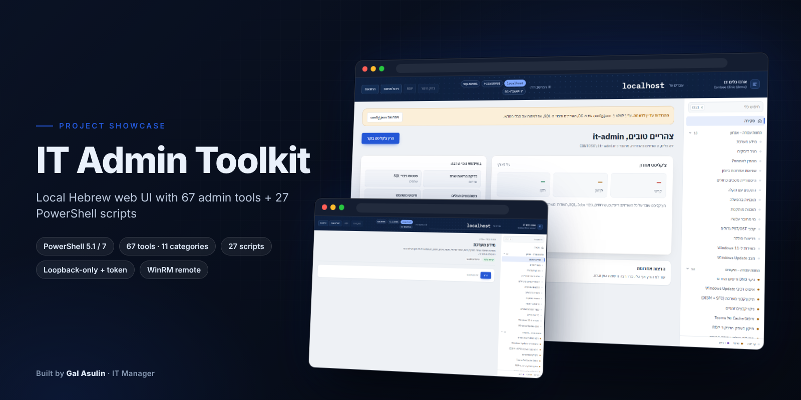
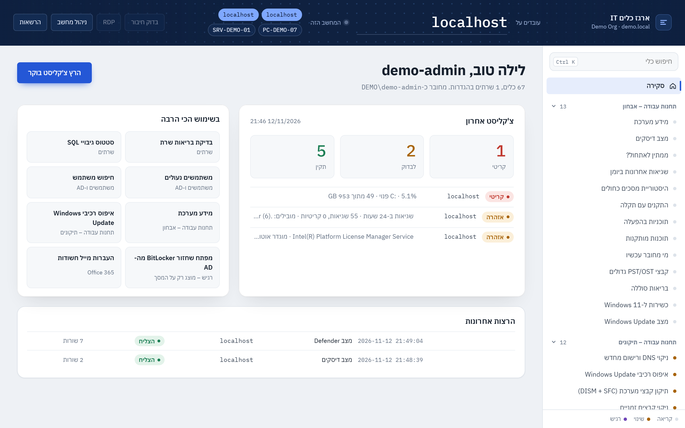
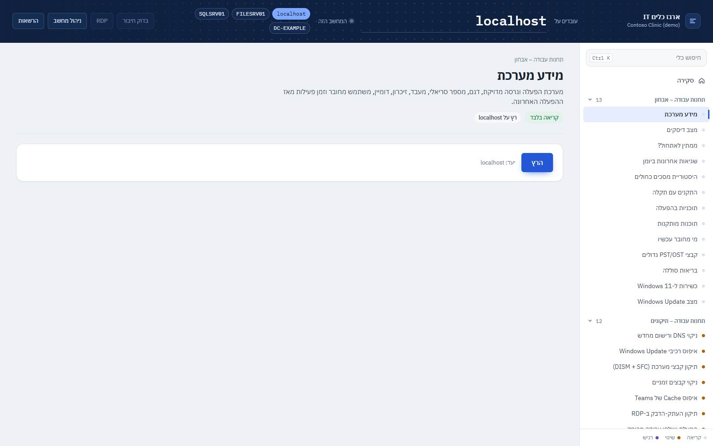
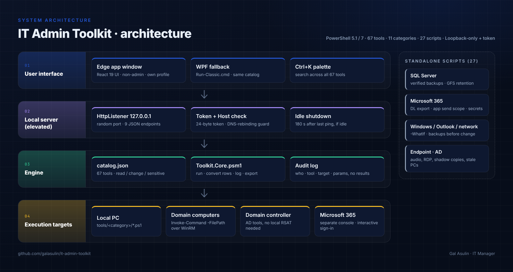
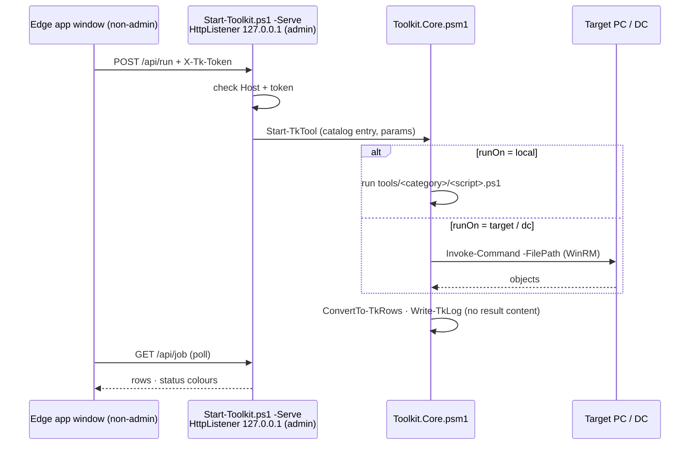

<p align="center"><a href="https://galasulin.github.io/it-admin-toolkit/"></a></p>

<div align="center">

# IT Admin Toolkit

**A local Hebrew web UI with 67 admin tools, plus 27 field-tested PowerShell scripts from running IT for a multi-branch clinic network.**

🇬🇧 English · 🇮🇱 [עברית](README.he.md)


[**Live page**](https://galasulin.github.io/it-admin-toolkit/) · [Screens](#screens) · [Architecture](#architecture) · [Tech](#technical-parameters)

</div>

## At a glance

| | |
|---|---|
| **Type** | Local admin web app (PowerShell back end, React UI) + standalone PowerShell / T-SQL script library |
| **Status** | Actively used and maintained |
| **Stack** | PowerShell 5.1 / 7 · `HttpListener` · WinRM · React 19 · Vite 8 · GSAP · WPF fallback |
| **My role** | Author: every tool and script, the app, the UI and the docs page |
| **Live demo** | [galasulin.github.io/it-admin-toolkit](https://galasulin.github.io/it-admin-toolkit/) (catalog of all tools and scripts) |
| **Languages** | Hebrew (app UI) · English (scripts, comment-based help) |

## Screens

<table>
<tr>
<td width="50%"><a href="docs/screenshots/app-home.png"></a><br><sub><b>Home</b> · target picker, morning checklist, most-used tools, sidebar of 11 categories</sub></td>
<td width="50%"><a href="docs/screenshots/app-tool.png"></a><br><sub><b>Tool page</b> · description, risk tag, target and run button</sub></td>
</tr>
</table>

<sub>Screenshots use demo data (Contoso, example servers).</sub>

## What it is

Most admin scripts live as one-off `.bat` files on a desktop, full of hard-coded server names and shares. This repository is my own collection, written over years of supporting branches, servers and users, cleaned up so anyone can run it: **no hard-coded environment, every value is a parameter, every change is previewable**. Old batch files were rewritten in PowerShell where that made them safer or simpler.

It has two parts. `app/` is a local Hebrew web UI that runs **67 tools in 11 categories** on this PC, on any domain computer over WinRM, or on the domain controller. The script folders hold **27 standalone scripts** for SQL Server backups, Microsoft 365, Windows Update, Outlook, networking, endpoints and AD.

## Key capabilities

### The app: 67 tools in 11 categories

| Category | Tools | Examples |
|---|:-:|---|
| Workstation diagnostics | 13 | System info, disk status + SMART, pending reboot, BSOD history, problem devices, Windows 11 readiness, large PST/OST files |
| Workstation fixes | 12 | DNS flush/re-register, Windows Update reset, DISM + SFC, Teams cache reset, RDP clipboard fix, scheduled restart, restore point |
| Setup & upgrades | 5 | Standard apps via winget, available updates, update all, rename + domain join, Windows upgrade |
| Printers | 3 | Printer and queue status, spooler fix, network printer for all users |
| Servers | 5 | Server health, SQL backup status, SQL Agent jobs, expiring certificates, over-open shares |
| Users & AD | 8 | Find user, locked users, unlock, password reset, new user from template, disable leaver, group members, stale accounts |
| Office 365 | 6 | Distribution list members, suspicious forwarding, mailbox permissions, mailbox sizes, licences, MFA status |
| Security | 4 | Local admins, BitLocker status, Defender status, failed logons (from the DC) |
| Sensitive (on-screen only) | 5 | Saved Wi-Fi passwords, product keys, BitLocker recovery keys (local / AD), VirusTotal file check |
| Network | 3 | Connection and port test, WinRM reachability, network device scan |
| Reports | 3 | Morning checklist across all servers, computer inventory, scheduled daily report |

- **Risk model in code:** every tool in `catalog.json` is `read` (39), `change` (23) or `sensitive` (5). Read tools run immediately. Change tools show exactly what will happen, on which target and with which parameters, and run only after "yes". Sensitive tools ask before showing and again before saving to a file.
- **No deletes:** Windows Update and Teams folders are renamed, a leaver is disabled (not deleted), stuck print jobs are moved to a backup folder. The one exception, temp-file cleanup, says so in its confirmation dialog.
- **Audit log:** every run is written to `logs\toolkit-YYYY-MM.log` (who, when, tool, target, parameters, outcome). Result content is not logged, so passwords and keys never reach the log.
- **Passwords:** password reset and new user get a random temporary password shown once, with change-at-next-logon.
- **Exports and reports:** results export to CSV or HTML; the morning checklist can run as a Sun–Thu scheduled task and writes `reports\daily-YYYYMMDD.html`.
- **Ctrl+K** command palette over all tools; light and dark theme; fonts bundled locally, so the UI works offline.

### The scripts: 27 in 7 folders

#### SQL Server: [`sql/`](sql)

| Script | What it does |
|---|---|
| [`Backup-SqlDatabases.ps1`](sql/Backup-SqlDatabases.ps1) | FULL / DIFF / LOG backups with `CHECKSUM`, compression and optional `COPY_ONLY`, `RESTORE VERIFYONLY` on every file, retention that only removes its own verified file pattern, log file. |
| [`New-SqlBackupJob.sql`](sql/New-SqlBackupJob.sql) | T-SQL: a generic backup procedure (compressed, checksummed, `RESTORE VERIFYONLY`, retention) plus a daily SQL Server Agent job, for servers where backups should run inside SQL Server. |
| [`Invoke-BackupRetention.ps1`](sql/Invoke-BackupRetention.ps1) | Grandfather-father-son retention (10 daily / 4 weekly / 3 monthly) per database. Dry run by default; **never touches log backups**. |
| [`Invoke-SqlFile.ps1`](sql/Invoke-SqlFile.ps1) | Runs a `.sql` file (splits on `GO`) with Windows auth and writes every message and result set to an evidence log. No `sqlcmd` needed. |

#### Microsoft 365 / Exchange Online: [`m365/`](m365)

| Script | What it does |
|---|---|
| [`Export-DistributionLists.ps1`](m365/Export-DistributionLists.ps1) | Exports all distribution lists (and optionally Microsoft 365 groups) with members, owners and settings to **Excel** (ImportExcel), or CSV when the module is missing. Nested lists can be expanded. |
| [`Set-AppMailSendScope.ps1`](m365/Set-AppMailSendScope.ps1) | Restricts an Entra app to send mail **only** as chosen mailboxes using RBAC for Applications, then proves it with a positive and a negative test. |
| [`Watch-AppSecretExpiry.ps1`](m365/Watch-AppSecretExpiry.ps1) | Daily tripwire before an app client secret expires (log, event log, pop-up). Integrations otherwise fail silently. |
| [`Set-OneDrivePolicies.ps1`](m365/Set-OneDrivePolicies.ps1) | OneDrive silent sign-in, Files On-Demand and download-size prompt via policy keys, for unmanaged PCs. |

#### Windows Update: [`windows-update/`](windows-update)

| Script | What it does |
|---|---|
| [`Reset-WindowsUpdate.ps1`](windows-update/Reset-WindowsUpdate.ps1) | The classic repair: stop services, rename `SoftwareDistribution` / `catroot2`, restart, optional DISM + SFC and a new scan. `-StopOnly` just stops the service. |
| [`Remove-WindowsUpdatePackage.ps1`](windows-update/Remove-WindowsUpdatePackage.ps1) | Removes a bad update by KB **or DISM package name** (works for cumulative "RollupFix" packages that `wusa` cannot remove), optional pause. |

#### Outlook: [`outlook/`](outlook)

| Script | What it does |
|---|---|
| [`Backup-OutlookData.ps1`](outlook/Backup-OutlookData.ps1) | Copies a user's signatures, Outlook settings and PST (optionally OST) files with robocopy, plus a restore guide. |
| [`Set-OutlookRegistryFixes.ps1`](outlook/Set-OutlookRegistryFixes.ps1) | Per-version Outlook fixes: disable `winmail.dat` (TNEF), legacy GAL properties dialog, more Exchange accounts per profile, with `.reg` backups and `-Revert`. |
| [`Remove-OfficeMsiPatch.ps1`](outlook/Remove-OfficeMsiPatch.ps1) | Removes a single MSI Office patch (default: the update that made Outlook 2010 start in safe mode). |

#### Network: [`network/`](network)

| Script | What it does |
|---|---|
| [`Add-FirewallPortRule.ps1`](network/Add-FirewallPortRule.ps1) | Firewall rules from presets (SQL Server, SSAS, RDP, ping) or custom ports, idempotent, scoped by profile and source. |
| [`Export-FirewallConfig.ps1`](network/Export-FirewallConfig.ps1) | Exports the firewall policy (`.wfw`) and a CSV of all rules; import / reset with an automatic backup first. |
| [`Set-DnsServers.ps1`](network/Set-DnsServers.ps1) | Sets static DNS servers or back to DHCP, then flushes and re-registers DNS. |
| [`Repair-TimeSync.ps1`](network/Repair-TimeSync.ps1) | Fixes Windows Time: domain hierarchy or manual NTP peers, backup of the settings, forced resync. |
| [`Connect-NetworkDrives.ps1`](network/Connect-NetworkDrives.ps1) | Maps drives from a CSV, persistently, with an optional prompted credential. No passwords in files. |

#### Endpoint: [`endpoint/`](endpoint)

| Script | What it does |
|---|---|
| [`Get-EndpointInfo.ps1`](endpoint/Get-EndpointInfo.ps1) | One-file helpdesk report: user & groups, network, OS, serial / service tag, disks, GPU, installed programs. |
| [`Get-LocalAdmins.ps1`](endpoint/Get-LocalAdmins.ps1) | Audits local Administrators group members on one or many PCs (language-independent SID) to CSV. |
| [`Clear-PrintSpooler.ps1`](endpoint/Clear-PrintSpooler.ps1) | Clears stuck print jobs locally or remotely. |
| [`New-ShadowCopy.ps1`](endpoint/New-ShadowCopy.ps1) | Creates "Previous Versions" shadow copies and optionally sizes shadow storage. |
| [`Repair-RdpClientLicenseStore.ps1`](endpoint/Repair-RdpClientLicenseStore.ps1) | Fixes the RDP client "licensing protocol" error for standard users, with ACL backup and restore. |
| [`audio/Get-AudioDiagnostics.ps1`](endpoint/audio/Get-AudioDiagnostics.ps1) | Read-only deep diagnosis of choppy audio: endpoint formats, APO chain, drivers, power, live DPC latency, event logs. |
| [`audio/Repair-AudioStutter.ps1`](endpoint/audio/Repair-AudioStutter.ps1) | Report / `-Apply` / `-Rollback` fix for Nahimic-related stutter, Fast Startup and battery CPU floor. |
| [`audio/Test-AudioFix.ps1`](endpoint/audio/Test-AudioFix.ps1) | PASS / FAIL verification after the fix. |

#### Active Directory: [`ad/`](ad)

| Script | What it does |
|---|---|
| [`Move-StaleComputers.ps1`](ad/Move-StaleComputers.ps1) | Reports computers inactive for N days; optionally disables them (with a description stamp) and moves them to an OU. |

## Architecture



`Run.cmd` starts `Start-Toolkit.ps1` in two stages. The first stage, without elevation, picks a free loopback port and a random 24-byte token, starts the server stage elevated, and opens Edge in app mode with a separate profile and **without** admin rights. The server stage is a PowerShell `HttpListener` bound to `127.0.0.1` only; it serves the built React UI from `web/` and a small JSON API. Every request must carry the per-run token and a `Host` header of exactly `127.0.0.1:<port>` (DNS-rebinding guard). `modules/Toolkit.Core.psm1` resolves the tool in `catalog.json`, runs its script locally or sends the same file to the target with `Invoke-Command -FilePath` over WinRM, converts the output to rows, writes the audit log and exports CSV/HTML. Microsoft 365 tools open a separate console because sign-in is interactive.

### Flow



## Technical parameters

| Parameter | Value |
|---|---|
| App tools | 67 entries in `app/catalog.json`, 11 categories |
| Risk levels | 39 `read` · 23 `change` · 5 `sensitive` |
| Where tools run | 44 on a chosen target · 10 on the domain controller · 7 local · 6 in a separate console (Microsoft 365) |
| Tools with parameters / actions | 30 with `params` · 24 with follow-up `actions` |
| Standalone scripts | 27 (26 `.ps1` + 1 `.sql`) in 7 folders, 3,751 lines |
| App PowerShell code | `Start-Toolkit.ps1` 309 lines · `Start-Classic.ps1` 319 · `Toolkit.Core.psm1` 185 · tools + core 2,240 lines total |
| Local API | `HttpListener` on `127.0.0.1:<random port>` · 9 endpoints (`bootstrap`, `run`, `job`, `stop`, `export`, `open`, `cred`, `ping`, `quit`) |
| Request auth | 24-byte random token per run (`X-Tk-Token`) + exact `Host` header check |
| Idle shutdown | Server exits 180 s after the last ping, only when no tool is running |
| Remote execution | WinRM / `Invoke-Command -FilePath`; tool scripts are self-contained (`param([hashtable]$P)`) |
| UI | React 19.3, Vite 8.3, GSAP 3.15, Lenis, Motion; built bundle ~433 KB JS + ~30 KB CSS; IBM Plex Sans Hebrew / Mono bundled |
| Fallback UI | WPF window (`Run-Classic.cmd`, `ui/MainWindow.xaml`), same catalog |
| Runtime | Windows PowerShell 5.1 or PowerShell 7 · Windows 10 / 11 / Server · Edge (app mode) |
| Encoding | UTF-8 with BOM (required for Hebrew on Windows PowerShell 5.1) |
| Optional modules | `ExchangeOnlineManagement`, `Microsoft.Graph.Authentication`, `ImportExcel`, RSAT `ActiveDirectory` |
| QA | `qa/QA.ps1` runs every read-only tool on the local PC and saves results to `qa/qa-results.json`; it never runs a changing tool |
| Docs page | `docs/index.html` generated by `docs/build_page.py` from `catalog.json` and the scripts' `.SYNOPSIS` |

## Engineering decisions

| Decision | Why | Trade-off |
|---|---|---|
| **Local web UI on a loopback `HttpListener`, not a hosted service** | No install, no agent, no open port on the network. Token + `Host` check block other local pages and DNS rebinding. | Runs per admin PC; no shared multi-user console. |
| **Server elevated, browser not** | Tools need admin rights; the browser rendering them does not. | Two processes and a UAC prompt on every start. |
| **Self-contained tool scripts sent with `Invoke-Command -FilePath`** | One file works locally and remotely over WinRM with nothing installed on the target. | No dot-sourcing of shared helpers; some code repeats across tools. WinRM must be enabled on workstations. |
| **Catalog-driven UI with a risk level per tool** | Adding a tool is a script plus one `catalog.json` entry; confirmation rules come from the risk level, not from each tool. | Risk is declared, so a wrong label is a review issue. |
| **Rename, disable, move; never delete** | Every fix is reversible by hand. | Leftover renamed folders and disabled accounts need periodic cleanup. |
| **Log metadata, not results** | A full audit trail without storing passwords, keys or personal data. | Past results can't be re-read from the log. |

## How to run

### The app

1. Extract the folder, for example to `C:\IT-Toolkit`.
2. Copy `app/config.example.json` to `app/config.json` (git-ignored) and fill in your DC, servers, SQL instances and backup folders. If it is missing, the app creates it from the example and shows a banner with a button that opens it.
3. Double-click `app/Run.cmd`, approve UAC, and an Edge app window opens. If nothing opens, `app/Run-Classic.cmd` starts the WPF window with the same tools.

| `config.json` field | Meaning |
|---|---|
| `OrgName` | Name shown in the header |
| `DomainController` | DC name; AD tools run on it, so RSAT is not needed locally |
| `Servers` | Server list. `SqlInstances`: `.` for the default instance or `.\NAME` for a named one. `SqlDatabases`: databases that must be backed up |
| `Targets` | Extra computers in the target list |
| `BackupFolders` | Shares with backup files; the morning checklist checks for a file newer than `MaxAgeHours` |
| `StandardApps` | winget IDs for every new PC |
| `VirusTotalApiKey` | Free key for the VirusTotal tool |
| `DiskWarnPercent` / `DiskCriticalPercent` | Free-space thresholds |
| `SqlFullBackupMaxHours` | Allowed hours without a Full/Diff backup |

**Remote targets** need WinRM: usually on for servers; for workstations enable *Allow remote server management through WinRM* by GPO and open the `Windows Remote Management (HTTP-In)` firewall rule, or run `Enable-PSRemoting -Force` on a single PC.

**Adding a tool:** write `tools\<folder>\<Name>.ps1` starting with `param([hashtable]$P = @{})` that returns objects (a `מצב` column with `תקין` / `אזהרה` / `קריטי` colours the rows), keep it self-contained, add an entry to `catalog.json`, save as UTF-8 with BOM.

**Changing the UI:** needs Node.js. In `app/ui-src` run `npm install` then `npm run build`; the output goes to `app/web/`.

### The scripts

```powershell
# 1. Read the help first - every script documents its parameters, requirements and risks
Get-Help .\sql\Backup-SqlDatabases.ps1 -Full

# 2. Allow local scripts for this session only (no machine-wide change)
Set-ExecutionPolicy -Scope Process -ExecutionPolicy Bypass -Force

# 3. Preview, then run
.\windows-update\Reset-WindowsUpdate.ps1 -WhatIf
.\windows-update\Reset-WindowsUpdate.ps1
```

- Scripts are saved as **UTF-8 with BOM**, so Windows PowerShell 5.1 reads them correctly.
- Most system-changing scripts need an **elevated** PowerShell (stated in each script's `.NOTES`).
- Optional modules: `ExchangeOnlineManagement`, `ImportExcel`, RSAT `ActiveDirectory`.
- Values in angle brackets such as `<FILE_SERVER>`, `<ADMIN_UPN>` or `<TENANT_ID_GUID>` are placeholders. Replace them with your own.

## Safety

These scripts change servers, services, registry, firewall and backups. They are built to be careful: `-WhatIf` / `-Confirm` everywhere a change is made, dry runs by default for anything that deletes, backups (`.reg`, `.wfw`, ACL) before modifications, and rollback switches where possible. They are still provided **as is**. Test in a lab or on one machine first, read the help, and keep backups.

## Stack

PowerShell 5.1 / 7 · Windows 10 / 11 / Server · SQL Server (T-SQL, System.Data.SqlClient) · Exchange Online PowerShell (ExchangeOnlineManagement) · Microsoft Graph · ImportExcel · Active Directory module · NetSecurity / DnsClient · DISM · robocopy · WMI / CIM · WinRM · React · Vite · WPF

## My role

I am the IT manager of a physiotherapy clinic network with several branches. I wrote these scripts for real incidents and recurring chores (server backups, Microsoft 365 administration, broken updates, Outlook problems, branch networking and helpdesk work) and later cleaned them up, generalized them and documented them for publication. Some of the newer ones were written together with an AI coding assistant under my direction and reviewed and tested by me.

## Status

Actively used and maintained. Issues and pull requests are welcome.

## Repository layout

```
.
├── app/                       # local web app
│   ├── Run.cmd / Run-Classic.cmd
│   ├── Start-Toolkit.ps1      # launcher + loopback HTTP server
│   ├── Start-Classic.ps1      # WPF fallback window
│   ├── Run-DailyReport.ps1    # morning report without a window
│   ├── catalog.json           # 67 tools: category, risk, runOn, params
│   ├── config.example.json
│   ├── modules/Toolkit.Core.psm1
│   ├── tools/                 # ad, fixes, m365, network, printers, security,
│   │                          # sensitive, servers, setup, workstation
│   ├── web/                   # built UI (what actually runs)
│   ├── ui-src/                # React source (Vite)
│   ├── ui/MainWindow.xaml
│   └── qa/                    # read-only QA runner
├── sql/  m365/  windows-update/  outlook/  network/  endpoint/  ad/   # 27 scripts
├── docs/                      # GitHub Pages: index.html, build_page.py, screenshots/
├── LICENSE                    # MIT
└── README.md / README.he.md
```

## Privacy & scope

Everything environment-specific was removed before publishing: server and computer names, domains, user names, mailboxes, shares, IP addresses, tenant and app IDs, and credentials are now parameters or neutral placeholders (`contoso.local`, `<SQL_SERVER>`, `\\<FILE_SERVER>\<SHARE>`). No real organization data, logs or exports are included, and `.gitignore` keeps script output (`logs/`, `exports/`, CSV/XLSX) and `config.json` out of the repository. Screenshots use demo data.

---

<div align="center"><b>Built by <a href="https://github.com/galasulin">Gal Asulin</a>, IT Manager</b></div>
